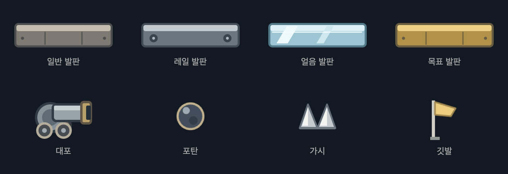

# TokenJump

AI 코딩 토큰을 점프 에너지로 사용하는 macOS 14+ 메뉴바 게임. Swift/AppKit/SpriteKit 기반이며 외부 패키지 의존성이 없습니다.

## 실행

```sh
./build-app.sh
open 'dist/Token Jump.app'
```

체험 모드는 실제 잔액과 별도로 저장됩니다.

```sh
open 'dist/Token Jump.app' --args --demo
```

## 조작과 UI

- 메뉴바는 자체 벡터 아이콘 하나입니다. `Assets/TokenJump.svg`가 원본이며 앱은 같은 도형을 템플릿 이미지로 그립니다.
- 왼쪽 **게임**, 오른쪽 **사용량**. 게임 맵 안의 텍스트는 점프 횟수만 표시합니다. 도착지는 노란 깃발입니다.
- A/D 또는 좌우 방향키 이동, Space/W/위 방향키 점프, R 현재 맵 재시작, 클리어 후 N 다음 맵, Esc 닫기.
- 게임 탭의 시작 화면에서 난이도와 해금된 스테이지를 선택합니다. ⚙️ 메뉴에서는 캐릭터·서체 라이선스·종료를 선택합니다. 난이도는 첫 점프 전 선택하고, 시작 후에는 전체 12개 맵을 클리어해야 변경할 수 있습니다.
- 현재 스테이지를 클리어해야 다음 맵이 해금됩니다. 클리어 화면의 다음 버튼 또는 N / Enter로 진행합니다. 잠금 상태는 재시작 후에도 유지됩니다.
- 사용량 탭과 닫힌 팝오버에서는 게임·포탄 시간이 멈춥니다.

## 난이도

| 난이도 | 점프 1회 비용 | 초반 발판 폭 |
|---|---:|---:|
| 쉬움 | 5,000 토큰 | 120pt |
| 보통 | 10,000 토큰 | 90pt |
| 하드 | 25,000 토큰 | 60pt |

출발 최소 횟수 제한은 없습니다. 잔액이 1회면 바로 점프할 수 있고, 0회면 점프를 차단하고 충전 안내를 표시합니다.

전체 클리어 후 난이도를 선택하면 새 도전을 1번 맵부터 시작하며 토큰 잔액은 유지합니다. 실제 점프할 때만 1회씩 차감합니다. 공중 재점프는 불가능합니다. 피격되거나 발판을 벗어나도 실제 발판에 착지하기 전에는 다시 점프할 수 없습니다. 착지 전 입력 예약과 발판 이탈 직후 점프 유예도 적용하지 않습니다.

## 스테이지

| 번호 | 구성 |
|---|---|
| 1 | 기본 도약 · 어려움에서는 승강·시간제·붕괴·회전 가시 |
| 2 | 승강 발판 |
| 3 | 스위치와 좌우 이동 발판 |
| 4 | 바람과 왼쪽 포대 |
| 5 | 열쇠와 빙판·가시 |
| 6 | 회전 가시와 오른쪽 포대 |
| 7 | 빙판·바람과 왼쪽 포대 |
| 8 | 스위치·시간제 발판과 오른쪽 포대 |
| 9 | 열쇠 2개와 바람·정밀 발판 |
| 10 | 바람·이동 발판과 왼쪽 포대 |
| 11 | 위쪽 구간 스위치와 붕괴 발판·오른쪽 포대 |
| 12 | 열쇠 2개와 복합 장애물·왼쪽 포대 |

쉬움·보통의 기본 경로는 1~5번 4회, 6~8번 5회, 9번 8회, 10번 10회, 11번 11회, 12번 12회 점프로 구성됩니다. 어려움 1~8번은 별도 경로로 6~9회 도약 구간이 있습니다. 실제 최소 점프 수는 발판 건너뛰기와 장애물 타이밍에 따라 달라집니다. 긴 코스는 구간 입구에 착지할 때만 화면이 전환됩니다. 후반으로 갈수록 발판은 좁아지고 이동 폭과 포탄 속도·빈도가 증가합니다. 가시 발판은 폭을 넓혀 가시를 피해서 착지할 공간을 둡니다.

3번에서 레일 발판, 5번에서 빙판을 처음 만납니다. 레일 발판은 3/6/8/10/12번, 빙판은 5/7/9/11/12번에 배치됩니다. 레일 위에 올라타면 같이 이동하며, 얼음 위에서는 키를 놓거나 반대로 눌러도 관성이 남습니다. 탭을 바꾸거나 닫으면 발판 시간도 멈춥니다.

동시에 양쪽 포대를 두지 않습니다. 포격 예고선·궤적 안내선은 없습니다. 가시는 실제 발판의 중앙 또는 양쪽에 배치되어 빈 쪽으로 착지해야 합니다. 얇은 발판은 위로 통과하고 하강 시 착지합니다. 걸어서 발판 밖으로 벗어나면 떨어집니다. 낙하하거나 가시에 닿으면 모든 맵에서 첫 발판으로 복귀합니다. 소비한 토큰은 환급하지 않습니다.

## 데이터와 검증

Codex `~/.codex/sessions` 및 Claude Code `~/.claude/projects`의 로컬 JSONL 토큰 사용량을 60초마다 집계합니다. 최초 실행 이전 기록은 충전하지 않습니다. 웹 채팅·Grok·커스텀 로그 경로는 미지원입니다. 새 사용량/점프 소비 통계는 통계 기능 추가 이후부터 집계하므로 기존 잔액과 다를 수 있습니다.

```sh
.build/release/TokenJump --self-test
.build/release/TokenJump --progression-test
.build/release/TokenJump --platform-test
.build/release/TokenJump --game-test
.build/release/TokenJump --combat-test
.build/release/TokenJump --ui-test --demo
.build/release/TokenJump --hazard-test
.build/release/TokenJump --feature-test
.build/release/TokenJump --font-test
.build/release/TokenJump --art-test
```

그래픽을 사용하는 검증은 macOS 그래픽 세션이 필요합니다. 기본 경로 검증은 대포·동적 발판을 끄고 108개 스테이지·난이도·FPS 조합에서 착지를 확인합니다. 대포/배치/HUD는 별도로 검사합니다. 자동 검증과 실제 UI 육안 확인은 구분합니다.

서비스 로고 캐릭터는 포함하지 않고 자체 캐릭터 3종을 제공합니다. 상표 검토와 제한 사항은 [제품 검토](docs/PRODUCT-REVIEW.md)를 참고하세요.

사용량 화면은 시스템 배경과 구분선 목록으로 구성되며, 큰 카드나 장식 표어 없이 잔액·점프 소비·사용한 점프·서비스별 집계를 표시합니다.

순차 진행 기능 이전의 자유 선택 기록은 클리어 증거로 보지 않으므로, 업그레이드 시 기존 토큰 잔액을 보존하고 1번 맵부터 시작합니다.

## 게임 이미지

발판·레일·빙판·대포·포탄·가시·목표 깃발은 [직접 제작한 SVG](Assets/Sprites/)를 사용합니다. 원본을 수정하고 다시 빌드하면 이미지도 갱신됩니다. 실행 중에는 변환된 이미지를 캐시하며, 충돌 영역은 이미지와 별도로 기존 게임 규칙을 유지합니다. `.build/release/TokenJump --art-test`로 리소스 로딩을 확인할 수 있습니다.



정상에 도착하면 클리어 안내와 다음 버튼이 나타납니다. N / Enter 키로도 다음 맵에 진입합니다. 마지막 정상에서는 전체 완주 안내와 난이도 선택 버튼이 표시됩니다. 중간 체크포인트 없이 첫 발판부터 재도전합니다.

게임 탭의 시작 화면에서 난이도와 스테이지를 고른 뒤 시작합니다. 잠긴 단계와 완료한 단계를 같은 목록에서 확인할 수 있으며, 플레이 중 상단의 ‘스테이지’로 돌아오면 게임은 일시 정지합니다. 난이도는 첫 점프부터 전체 완주까지 고정됩니다. 정상 도착 안내에는 ‘N 키로 다음 스테이지’를 표시합니다. 남은 점프가 0회이면 충전 안내가 나타나고, 토큰이 집계되어 점프가 가능해지면 자동으로 사라집니다.

어려움은 1번부터 별도 지그재그 경로와 회전 십자 가시·보라색 시간제 발판·균열이 있는 주황색 붕괴 발판이 등장합니다. 보라색 발판은 사라지기 직전에 깜빡이고, 붕괴 발판은 밟은 뒤 어려움 0.45초/그 외 0.8초 후 사라졌다가 3초 뒤 복구됩니다. 중간 저장 없이 첫 발판으로 돌아가며 이동 발판의 레일/가동 범위는 표시하지 않습니다. `.build/release/TokenJump --hazard-test`는 36개 조합에서 실제 장애물 구간의 도약 타이밍·착지 위치, 발판의 충돌과 복구, 회전 가시 충돌, 첫 발판 복귀를 검사합니다. 이 검사는 대포를 끈 개별 구간 검사이며 전체 플레이 난도는 직접 플레이하며 조정합니다.

상하 이동 발판도 일부 스테이지에 등장합니다(쉬움·보통 2번부터, 어려움 1번부터). 시작/목표/방 경계와 정적 가시·소멸·붕괴·빙판·좌우 이동 발판은 승강 발판에서 제외합니다. 캐릭터를 함께 운반하며, 착지는 이전/현재 발판 높이의 상대 이동으로 계산합니다. 이동 경로는 표시하지 않고 청록색 금속 발판으로 구분합니다. 대포 높이는 기본 지형을 기준으로 고정합니다. `--platform-test`에서 모든 난이도와 30/60/120 FPS로 승강 중 접촉 유지와 토큰 미소비를 검증합니다.

## 맵별 목표와 바람

- 3·8·11번: 발판 위 주황색 스위치를 직접 밟아 다음 발판을 켭니다. 중앙 착지만으로 켜지지는 않습니다.
- 5·9·12번: 열쇠에 닿아 수집하면 골인 잠금이 풀립니다. 사라진 발판의 열쇠는 수집할 수 없습니다.
- 4·7·9·10·12번: 청록색 바람 입자가 보이는 높이에서 공중에 있는 캐릭터가 바람 방향으로 밀립니다. 서 있을 때는 밀리지 않습니다.
- 실패 시 열쇠와 스위치는 초기화됩니다. 게임을 닫거나 사용량 탭으로 가면 바람/발판 시간도 정지합니다.
- 선택 화면에 맵별 공략을 표시하고 세 단계마다 배경 색감을 바꿉니다. `--feature-test`로 스위치 접촉, 골인 잠금, 수집/초기화, 바람 방향과 토큰 미차감을 검사합니다.

## 게임 서체

눈누에서 찾은 [갈무리11](https://noonnu.cc/font_page/801)을 게임 숫자·스테이지 선택·클리어 안내에 적용합니다. 사용량 화면은 시스템 서체를 유지합니다. 폰트 원본 한 종(약 5.4MB)과 [OFL 1.1 원문](Assets/Fonts/OFL.txt)을 앱에 함께 포함하며, 앱 프로세스 안에서만 등록해 사용합니다. 별도 설치나 실행 시 다운로드가 없습니다. 설정 메뉴에서 원문을 열 수 있습니다. [제3자 고지](THIRD_PARTY_NOTICES.md)를 참고하세요. `--font-test`로 번들 등록과 한글·숫자·화살표 글리프 및 고지 포함을 검사합니다.
